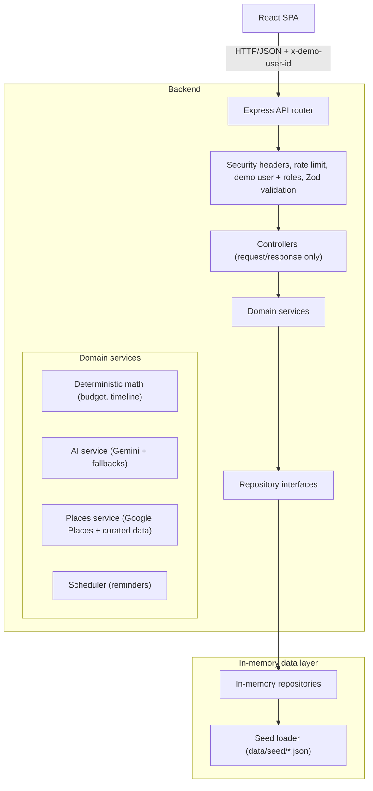

# PlanIt: GenAI Event Planning Assistant

> **Problem statement:** Create a GenAI-powered planning assistant that helps users organize weddings, birthdays, and community events with budgets, timelines, vendor checklists, and personalized ideas.

PlanIt turns a plain-language description of an event into a complete, editable plan. A GenAI layer handles language and reasoning (intake, explanations, ideas, writing). Deterministic code handles everything that must be exact (budget math, dates, validation). The app runs fully on in-memory dummy data, so no database or API key is needed to try it.

## 🎯 Code Quality & Architecture

PlanIt demonstrates production-ready code quality through:

**Separation of Concerns**
- AI orchestration, fallback data, and validation logic separated into focused modules
- Business logic isolated from presentation layer
- Repository pattern with clean interfaces for data access

**GenAI + Deterministic Hybrid**
- LLM generates creative content and reasoning (ideas, explanations, recommendations)
- Code performs exact calculations (budget totals, date scheduling, constraint enforcement)
- All AI outputs validated before use with structured error handling
- High-quality curated fallbacks ensure full functionality without API keys

**Testing & Reliability**
- 293 passing tests covering units, services, API routes, repositories, and components
- Deterministic tests (no live AI calls in test suite)
- Type safety with TypeScript throughout
- Accessibility compliance with jest-axe automated checks

**Documentation**
- Comprehensive AI architecture documentation (`docs/AI_ARCHITECTURE.md`)
- Detailed inline code comments
- Clear separation between AI-generated and code-calculated data

For detailed AI workflows, validation strategy, and architectural decisions, see [`docs/AI_ARCHITECTURE.md`](./docs/AI_ARCHITECTURE.md).

---

## Table of contents

1. [Problem statement to features](#1-problem-statement-to-features)
2. [Quick start](#2-quick-start)
3. [Demo script for judges](#3-demo-script-for-judges-3-minutes)
4. [How the GenAI works](#4-how-the-genai-works)
5. [Architecture](#5-architecture)
6. [Data layer and repository pattern](#6-data-layer-and-repository-pattern)
7. [Folder structure](#7-folder-structure)
8. [Design system](#8-design-system)
9. [Security](#9-security)
10. [Testing](#10-testing)
11. [Accessibility](#11-accessibility-wcag-21-aa)
12. [Scripts](#12-scripts)

---

## 1. Problem statement to features

### Core requirements

| Requirement | How PlanIt delivers it | Where |
|---|---|---|
| **GenAI-powered planning assistant** | Gemini 2.5 Flash returns structured JSON for intake, budget reasoning, timeline tasks, ideas, messages, risks, and optimizer suggestions. Every output is validated with Zod before use. | `src/server/services/ai/` |
| **Weddings, birthdays, community events** | Three event types, each with its own template: budget split, checklist, timeline milestones, vendor categories, and tone. | `src/server/services/ai/`, `data/seed/` |
| **Budgets** | AI explains the split per category; code computes exact integer amounts (sum always equals total). Locked-category rebalancing, expense tracker, overspend warnings. | `src/shared/utils/deterministic-math.ts`, `BudgetView.tsx` |
| **Timelines** | AI proposes event-specific tasks; code schedules them backward from the event date and compresses lead times when the event is close. Day-of run-of-show included. | `src/shared/utils/deterministic-math.ts`, `TimelineView.tsx` |
| **Vendor checklists** | Five-stage status pipeline per vendor category (not started, contacted, quote received, booked, paid), plus vendor discovery. | `VendorsView.tsx`, `places.service.ts` |
| **Personalized ideas** | Themes, decor, menu, activities, and gifts generated from vibe, culture, budget, and guest profile. Regenerate on demand. | `ai.service.ts`, `IdeasView.tsx` |

### Selected extra features

| Feature | How PlanIt delivers it | Where |
|---|---|---|
| **Invitation and message generator** | Multiple formats and tones, English / Hindi / Gujarati, WhatsApp share link. Event facts are filled from event data, not invented by the model. | `ai.service.ts`, `InvitationsView.tsx` |
| **Risk and contingency advisor** | Context-specific risks (weather, vendors, food safety, timeline) with severity and a mitigation plan. | `ai.service.ts`, `RiskAdvisorView.tsx` |
| **Budget optimizer** | Three what-if scenarios (maintain quality, moderate cuts, aggressive savings). The AI suggests trade-offs; code recalculates totals so they stay exact. | `/api/budget/optimize`, `BudgetOptimizerModal.tsx` |
| **Vendor discovery** | Google Places (business profiles) with automatic fallback to a curated vendor dataset when no key is set. | `places.service.ts`, `/api/vendors/search` |
| **Collaboration** | Owner / editor / viewer roles enforced on the server, plus an activity log. | `demo-user.ts` middleware, `CollaborationView.tsx` |
| **Reminders and notifications** | In-process scheduler creates due-date and payment notifications shown in the notification center. | `scheduler.ts`, `NotificationCenter.tsx` |
| **Export** | Budget CSV, vendor CSV, and timeline ICS (RFC 5545) for calendar import. | `export-utils.ts` |

---

## 2. Quick start

No database and no API keys are required.

```bash
git clone https://github.com/Arunhere1907/Planit.git
cd Planit
cp .env.example .env
npm install
npm run dev
```

Open <http://localhost:3000>. Express serves the API under `/api/*` and the Vite dev middleware serves the React app.

### Environment variables

Both keys are optional. See `.env.example` for the full list.

| Variable | Purpose | If missing |
|---|---|---|
| `GEMINI_API_KEY` | Enables live Gemini output | Deterministic curated fallbacks are used and a log line says so |
| `GOOGLE_MAPS_API_KEY` | Enables live Google Places vendor search | Vendor search uses the curated vendor dataset |

### Dummy data

On startup the in-memory store is seeded from `data/seed/*.json`:

- **Wedding:** Aarav & Diya's Royal Ahmedabad Wedding (200 guests, ₹8 lakh, 18 Dec 2026, Jain/veg menu)
- **Birthday:** Arjun's 30th Rooftop Milestone (Bandra, Mumbai, 50 guests, ₹2 lakh)
- **Community event:** Navrangpura Eco-Diwali Cultural Mela, with a Navratri Garba Mahotsav variant for the demo
- Curated vendors for venues, catering, photography, decor, and music in Ahmedabad, Mumbai, Delhi, Jaipur, and Bengaluru

State resets on server restart. To reset on demand, use the refresh icon in the header, or:

```bash
curl -X POST http://localhost:3000/api/dev/reset
```

---

## 3. Demo script for judges (3 minutes)

1. **Wedding.** Open the app and select *Aarav & Diya's Royal Ahmedabad Wedding*. On the dashboard check guests, budget, and the days-left counter. Open **Budget** (categories with AI reasoning), **Timeline** (tasks scheduled backward from the event date), and **Run-of-Show** (hour-by-hour day plan).
2. **Birthday.** Switch to *Arjun's 30th Rooftop Milestone*. Note the different budget categories, vendor types (rooftop lounge, DJ, cake designer), ideas, and a lighter invitation tone.
3. **Community event.** Switch to the community festival. Note the stage/sound and permits/security priorities, crowd and sound-curfew risks, and a community-focused invitation in Gujarati.
4. **AI intake.** Click **New Event** and type: *"Plan a birthday party in Mumbai for 75 guests with ₹3 lakh budget in March"*. The AI extracts type, city, guests, and budget, then generates a budget and timeline. Missing critical details are asked as follow-up questions.
5. **Budget control.** In **Budget**, lock one category (e.g. Catering), then raise another (e.g. Venue by ₹50,000). Unlocked categories rebalance and the total stays exact. Add expenses to see overspend warnings.
6. **Vendors.** In **Vendors**, move a vendor through the status pipeline, open its questions-to-ask, and search for *Catering* in *Ahmedabad* (live Places results, or the curated dataset without a key).
7. **AI extras.** Generate **Ideas**, view **Invitations** in different tones and languages, open the **Risk Advisor**, and run the **Budget Optimizer** with the *Moderate cuts* scenario.
8. **Collaboration, reminders, export.** Switch demo user between Owner, Editor, and Viewer to see permissions change. Open the notification center. Export budget CSV and timeline ICS.

---

## 4. How the GenAI works

**Principle: the LLM does language and reasoning; code does math and dates.**

```
User input (natural language)
        |
        v
LLM (Gemini 2.5 Flash) -- system prompt: role, constraints, JSON schema
        |
        v
Structured JSON  -->  Response Validator (schema, types, ranges)
        |                      |
        v                      v
   ✓ Valid              ✗ Invalid --> Curated Fallback
        |
        v
Deterministic code: exact budget sums, backward date scheduling, guardrails
        |
        v
Validated, correct plan shown to the user and editable by them
```

### Where the LLM is used and where code takes over

| Feature | LLM | Code | Why |
|---|---|---|---|
| Intake | Extracts type, date, city, guests, budget, vibe, dietary needs from free text | Validates values, applies guardrails (valid date, minimum guests, budget range) | The model understands language; code enforces constraints |
| Budget | Explains why each category gets its share for this event type, city, and guest count | Computes integer amounts so categories sum exactly to the total; rebalances around locked categories | The model must never do arithmetic |
| Timeline | Proposes event-specific tasks and owners | Computes due dates backward from the event date and compresses when time is short | The model knows planning sequences; code does calendar math |
| Ideas | Generates themes, decor, menu, activities, gifts | Applies budget context to cost ranges | Creative work vs. numbers |
| Invitations | Writes copy in the chosen tone and language | Inserts real event facts into placeholders and builds share links | Facts must never be hallucinated |
| Risks | Identifies risks from season, city, venue type, and timeline | Assigns severity buckets and structures the output | Reasoning vs. data shaping |
| Budget optimizer | Suggests specific trade-offs (smaller venue, off-peak timing, DIY decor) | Recalculates every scenario so totals hit the target exactly | Suggestions vs. guaranteed math |

### Structured output and validation

- Each feature has its own system prompt in `src/server/services/ai/prompts/event-prompts.ts`.
- Prompts specify exact JSON schemas, validation rules, and quality standards.
- Requests use JSON mode (`responseMimeType: 'application/json'`) and a low temperature (0.2) so structure stays stable. Content still varies with the event's inputs.
- Every response is validated by `ai-response-validator.ts` with explicit error handling:
  - Budget: Validates category structure, checks percentages sum to ~100
  - Timeline: Verifies task fields, priorities, phases, offset days
  - Ideas: Confirms structure, effort levels, required fields
  - Risks: Checks severity/likelihood values, category types
- Invalid output triggers fallback gracefully with logging; malformed AI responses never corrupt user data.
- Guardrails: budget percentages sum to 100, dates cannot be in the past, guest count has a minimum.

### Fallbacks when keys are missing or rate limits hit

Every AI feature has a deterministic fallback, so the app is fully usable offline and during evaluation:

| Feature | Fallback |
|---|---|
| Intake | Pattern-based extractor (event type, guest count, budget in lakh/crore, city) |
| Budget | Event-type templates with standard percentage splits |
| Timeline | Event-type task lists with standard lead times |
| Ideas | Curated ideas per event type |
| Invitations | Template bank with personalization placeholders |
| Risks | Risk matrix for common scenarios (weather, vendors, food safety, timeline) |
| Vendor search | Curated vendor dataset |

Fallbacks are **not** placeholder data - they are production-quality responses based on event planning best practices. To test fallback mode, leave `GEMINI_API_KEY` empty. The server logs: `No valid GEMINI_API_KEY configured. Running with intelligent deterministic fallback.`

For detailed AI workflows, prompt engineering, and validation strategy, see [`docs/AI_ARCHITECTURE.md`](./docs/AI_ARCHITECTURE.md).

---

## 5. Architecture



Request flow: **route, controller, service, repository interface**. Controllers never touch data stores; services never touch `req`/`res`.

---

## 6. Data layer and repository pattern

The app runs 100% in memory with zero external database dependencies. Services depend only on contracts in `src/server/repositories/interfaces/`:

```typescript
export interface IEventRepository {
  findAll(): Promise<FullEventPlan[]>;
  findById(id: string): Promise<FullEventPlan | null>;
  create(plan: FullEventPlan): Promise<FullEventPlan>;
  update(id: string, updates: Partial<FullEventPlan>): Promise<FullEventPlan>;
  delete(id: string): Promise<boolean>;
  resetToSeed(seedPlans: FullEventPlan[]): Promise<void>;
}
```

### Plugging in a real database later

1. Implement the interface, e.g. `src/server/repositories/postgres/postgres-event.repository.ts`.
2. Swap the instance in `src/server/repositories/index.ts`:
   ```typescript
   export const eventRepository: IEventRepository = new PostgresEventRepository();
   ```
3. No controller, service, or route changes are needed.

---

## 7. Folder structure

```
src/
  server/
    server.ts                 # thin bootstrap entry point
    app.ts                    # Express setup, middleware, Vite dev mount
    config/                   # env.ts (Zod-validated env), constants.ts
    controllers/              # request/response shaping, no business logic
    services/
      ai/                     # LLM client, prompts, schemas, fallbacks
      places/                 # Google Places client + curated fallback
      notifications/          # reminder scheduler, mailer interface
    repositories/
      interfaces/             # repository contracts
      in-memory/              # generic store + implementations
      seed-loader.ts          # loads seed data at startup
      index.ts                # central exports
    middleware/               # demo-user + roles, error-handler, rate-limit, security, validate
    utils/                    # async-handler, logger
    errors/                   # AppError hierarchy
  shared/
    types/                    # domain interfaces (FullEventPlan, Task, BudgetCategory...)
    schemas/                  # Zod schemas
    utils/                    # deterministic-math, formatters, export-utils
    styles/tokens.css         # design tokens
  client/
    components/ui/            # Button, Card, Input, Badge, Modal, LiveRegion...
    components/layout/        # Header, navigation
    context/                  # DemoUserContext (Owner / Editor / Viewer)
    hooks/                    # usePlan
    services/api/             # fetch client + typed endpoint functions
  components/                 # feature views (Budget, Timeline, Vendors, Ideas...)
  App.tsx, main.tsx
  __tests__/                  # unit, services, api, repositories, components, accessibility
data/seed/                    # events, vendors, demo users (JSON)
```

---

## 8. Design system

Tokens live in `src/shared/styles/tokens.css`. Components use tokens only.

| Role | Color | Use |
|---|---|---|
| Primary (indigo) | `#4F46E5` (hover `#4338CA`, subtle `#EEF2FF`) | Brand, active navigation, primary buttons |
| Accent (amber) | `#F59E0B` (subtle `#FFFBEB`) | Festive highlights, badges |
| Neutrals (slate) | surface `#FFFFFF`, border `#E2E8F0`, headings `#0F172A` | Backgrounds, cards, text |
| Success | `#16A34A` | Paid, completed |
| Warning | `#D97706` | Budget 80-100%, upcoming deadlines |
| Danger | `#DC2626` | Overspend, overdue, destructive actions |

- **Red is reserved for errors and destructive actions, never navigation.** The active tab uses a subtle indigo background, bold indigo text, and a 3px indicator.
- Typography: fluid page title `clamp(1.75rem, 2.5vw, 2.25rem)`, section headings `1.375rem`, body in rem units. Amounts use `tabular-nums` and Indian notation (lakh / crore).
- Contrast: body text at least 4.5:1, large text and UI components at least 3:1.

---

## 9. Security

- **Input validation:** request bodies are validated with Zod; LLM output is validated before use.
- **Authorization:** owner / editor / viewer roles are enforced on the server for mutating routes, not only hidden in the UI.
- **Rate limiting:** an in-memory sliding-window limiter returns `429` when exceeded.
- **Security headers:** applied by `middleware/security.ts`.
- **Secrets:** API keys are read server-side only and never sent to the client. `.env` is git-ignored; `.env.example` contains placeholders.
- **Errors:** a central handler returns `{ error: { code, message } }` without internal details.
- **Dev tools:** the reset endpoint (`/api/dev/reset`) is for local demos.

---

## 10. Testing

Tests are deterministic and never call real external services.

```bash
npm test                # run all tests once
npm run test:watch      # watch mode
npm run test:coverage   # tests + coverage report (coverage/)
```

### What is covered

| Layer | Location | Focus |
|---|---|---|
| Unit | `src/__tests__/unit/` | Budget math (splits, locked rebalance, optimizer), timeline dates, formatters, Zod schemas, CSV/ICS export |
| Service | `src/__tests__/services/` | AI service and Places service with mocked clients, fallbacks, error handling |
| API | `src/__tests__/api/` | Every route via supertest: success, 400 validation, 404, 403 role denial, 429 rate limit, error shape |
| Repository | `src/__tests__/repositories/` | In-memory CRUD, event isolation, seed reset |
| Component | `src/__tests__/components/` | Budget view states (overspend colors, lock toggles, expenses) |
| Accessibility | `src/__tests__/accessibility/` | jest-axe checks on UI components, ARIA attributes, focus trapping |

### Determinism

- **Fixed time:** fake timers pinned to `2026-10-25T12:00:00Z` (`src/__tests__/setup.ts`).
- **Mocked externals:** the Gemini client, Google Places (`fetch`), environment variables, and the Vite server are all mocked.
- **No network, no API keys, no cost.** Tests run offline and in CI.

### Coverage thresholds (enforced in `vitest.config.ts`)

- Overall: 60%
- Services and shared utils: 80% lines, functions, statements; 75% branches

### CI

`.github/workflows/ci.yml` runs on every push and pull request: install, typecheck, lint, test with coverage, build.

---

## 11. Accessibility (WCAG 2.1 AA)

**Structure and semantics**
- `lang` attribute on the root element, semantic landmarks (`header`, `nav`, `main`), skip-to-content link
- One `h1` per view (visually hidden where the design has no visible title), dynamic page titles (e.g. "Budget - PlanIt"), focus moved to the heading on tab change
- Active navigation item uses `aria-current="page"`

**Keyboard and focus**
- Everything reachable and operable by keyboard; visible `:focus-visible` rings
- Modals: `role="dialog"`, `aria-modal`, `aria-labelledby`, focus trap, Escape to close, focus restored to the trigger

**Forms**
- Every input has an associated `<label>`; required fields use `aria-required`; errors use `aria-invalid` and `aria-describedby`

**Dynamic content**
- A reusable `LiveRegion` (`role="status"`, `aria-live="polite"`) announces AI progress and results, debounced to avoid spam
- Icon-only buttons have `aria-label`s; multilingual content carries `lang="hi"`, `lang="gu"`, or `lang="en"`

**Visual**
- Contrast meets AA; status is never color-only (badges have text such as PAID / PENDING / HIGH, budget bars show percentages)
- Touch targets at least 44x44px on coarse pointers; `prefers-reduced-motion` respected; layout works at 200% zoom

**How it is verified**
- `eslint-plugin-jsx-a11y` runs as part of `npm run lint`
- jest-axe tests in `src/__tests__/accessibility/`
- Manual keyboard walkthrough of all features

**Known limits:** automated tools catch only part of WCAG. A screen reader pass (NVDA, VoiceOver) and testing with real assistive-technology users are recommended before production use.

---

## 12. Scripts

```bash
npm run dev            # backend + Vite HMR
npm run build          # production build
npm run typecheck      # TypeScript static check
npm run lint           # ESLint (includes accessibility rules)
npm test               # test suite
npm run test:watch     # tests in watch mode
npm run test:coverage  # tests with coverage
```
